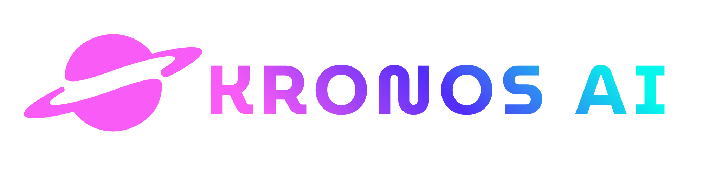
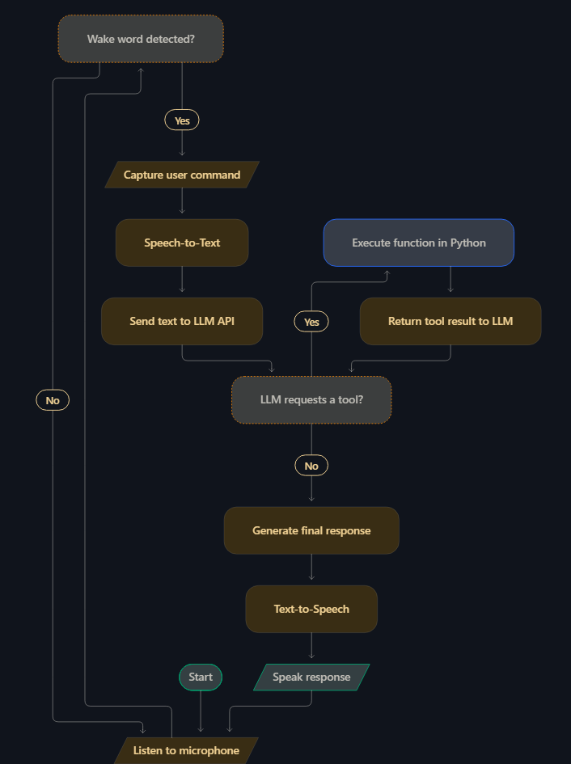

# Kronos AI Agent

**Kronos AI Agent** is a Python-based voice assistant designed to provide natural voice interaction with an AI language model through an API. The project aims to combine speech recognition, AI-powered responses, text-to-speech, and tool integration to create an intelligent assistant capable of understanding voice commands and performing tasks.

## Overview

Kronos AI Agent connects voice input to an AI model, allowing users to interact with the assistant through natural language. By integrating function calling and external tools, the system can go beyond text-based responses and execute actions through Python.

The project focuses on building a modular and extensible AI assistant that can be expanded with new capabilities over time.

## Key Features

- **Voice Interaction:** Communicate with the assistant using spoken commands.
- **Speech-to-Text:** Convert speech into text for AI processing.
- **AI Integration:** Connect to a large language model (LLM) through an API.
- **Text-to-Speech:** Convert AI-generated responses into spoken audio.
- **Function Calling:** Allow the AI model to request specific tools and functions.
- **Task Automation:** Execute supported actions through Python.
- **Wake Word Detection:** Activate the assistant when its name is detected.

## Technologies

- Python
- Grok API
- Speech Recognition
- Text-to-Speech (TTS)
- Function Calling
- Python Automation Libraries

## Project Goals

The main goal of Kronos AI Agent is to develop a voice-controlled AI assistant capable of understanding user requests, interacting with an LLM, and performing tasks through integrated tools.

The project is designed with extensibility in mind, allowing new tools, integrations, and automation capabilities to be added as development progresses.

## Project Status

🚧 **In Development**

Kronos AI Agent is an ongoing project. Features and capabilities may evolve as development continues.

## License

A license will be added when the project is ready for distribution.